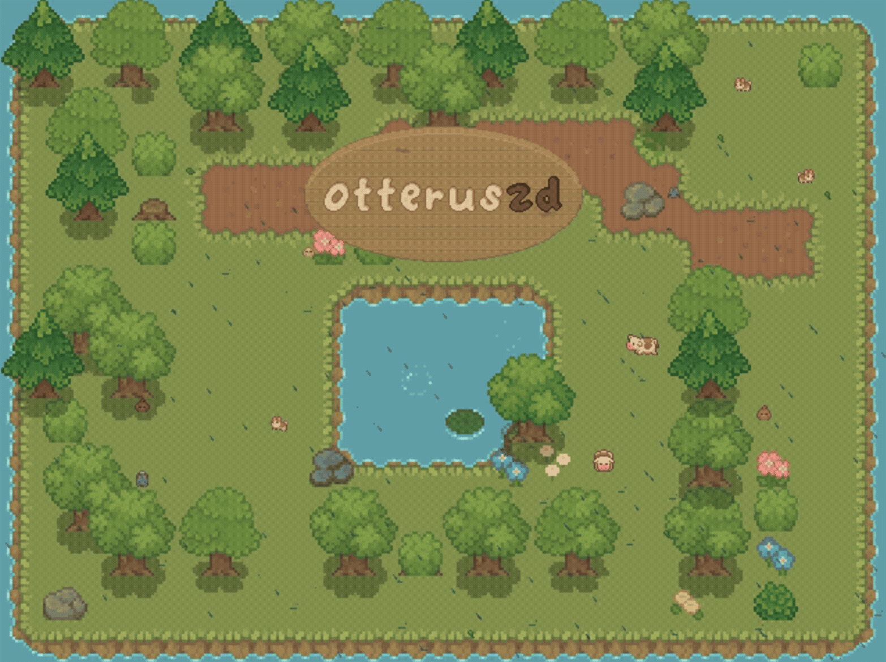

# Otterus2D

A modular 2D game engine built from scratch in **C++20** and **OpenGL 4.5 Core**, featuring an EnTT-based ECS, Box2D physics, and Lua scripting via Sol3.

<p align="center"></p>

<p align="center"><em>A cozy scene running on the engine: tilemap, animated sprites, particles and audio, all driven by Lua scripts.</em></p>

---

## Highlights

- **Batched 2D Renderer**: Dynamic geometry batching for sprites, primitives, and TrueType fonts on OpenGL 4.5 Core.
- **Data-Oriented ECS**: EnTT sparse-set registry providing cache-friendly linear memory iteration.
- **Lua Scripting Bridge**: Sol3/Lua 5.3 runtime exposing entities, components, input, and resources to game scripts.
- **Integrated Box2D Physics**: Rigid body simulation, collision filters, and event-driven contact callbacks.
- **Dear ImGui Workspace**: Integrated docking shell with scene viewport, asset controls, and structured log console.

---

## Quick Start

### Requirements
- Windows 10/11 (64-bit)
- Visual Studio 2022 (MSVC v143+) with C++20 support
- CMake 3.20+
- GPU with OpenGL 4.5 support

### Dependencies
Prebuilt third-party dependencies are packaged separately. Download [`dependencies-win-x64.zip`](https://github.com/Umair-Manzoor-47/Otterus2D/releases/tag/deps-win-x64-v1) and extract it into the repository root so that `Dependencies/` sits alongside `CMakeLists.txt`:

```powershell
# Clone the repository
git clone https://github.com/Umair-Manzoor-47/Otterus2D.git
cd Otterus2D

# Download and extract prebuilt dependencies
Invoke-WebRequest -Uri "https://github.com/Umair-Manzoor-47/Otterus2D/releases/download/deps-win-x64-v1/dependencies-win-x64.zip" -OutFile deps.zip
Expand-Archive deps.zip -DestinationPath .
Remove-Item deps.zip
```

### Build and Run
```powershell
# Configure and build Release
cmake -B build -S . -DCMAKE_BUILD_TYPE=Release
cmake --build build --config Release

# Launch the editor
cd build/bin/Release
.\OTTERUS_EDITOR.exe
```

---

## Documentation

Full developer documentation is organized using the **Diataxis framework** in the **[Documentation Portal](docs/README.md)**:

- **[Engine Architecture & Subsystems](docs/architecture/engine_overview.md)**: Layer rules, dependency boundaries, and the 4-phase frame execution lifecycle.
- **[ECS Components Reference](docs/reference/ecs_components.md)**: Signatures and data layouts for all 10 engine components.
- **[Lua Scripting API Reference](docs/reference/lua_api.md)**: Signature-first specifications for Entity, Registry, Input, Audio, Camera, and Timers.
- **[AssetManager Reference](docs/reference/asset_manager.md)**: Supported formats, texture filtering modes (`pixel_art`), and caching.
- **[Quickstart Tutorial: Building a 2D Scene](docs/tutorials/getting_started.md)**: Step-by-step guide to writing your first playable scene.
- **[How-To: Collision Detection](docs/how-to/handle_collisions.md)**: Box2D contact callbacks, `ObjectData`, and safe deferred destruction.
- **[How-To: Audio and Music](docs/how-to/play_audio_sfx.md)**: BGM streaming and 16-channel sound effect playback.

---

## Architecture

Otterus2D enforces a strict one-way dependency chain: upper layers may only include headers from layers below them.

<p align="center">
  
</p>

For full architectural rules, lifecycle diagrams, and subsystem invariants, see [Engine Architecture and Overview](docs/architecture/engine_overview.md).

---

## Features

| Subsystem | Capabilities |
| :--- | :--- |
| **Rendering** | Dynamic batching, layer-sorted sprites, primitives (rect, circle, line), TrueType text, 2D camera, framebuffers |
| **ECS** | EnTT registry managing transform, sprite, animation, collider, physics, text, and identification components |
| **Scripting** | Lua 5.3 bindings for entity lifecycle, input queries, audio, timers, and mathematical vectors |
| **Physics** | Static, kinematic, and dynamic Box2D bodies, sensor triggers, and contact listeners |
| **Audio** | Streamed music (MP3/OGG) and 16-channel concurrent sound effects (WAV) via SDL2_mixer |
| **Assets** | Centralized caching and deduplication for textures, shaders, fonts, and audio tracks |
| **Tooling** | Dear ImGui docking workspace, aspect-fit scene viewport, and structured logger with source locations |

---

## Design Decisions

| Decision | Implementation Rationale |
| :--- | :--- |
| **ECS over Inheritance** | Plain data structs stored in contiguous EnTT pools; systems iterate linearly with high cache locality. |
| **Batched Rendering** | Geometry is buffered into dynamic vertex arrays, sorted by layer and grouped by texture to minimize draw calls. |
| **Data-Driven Scripting** | Gameplay logic lives in Lua scripts via Sol3. Engine services and components are exposed without hard-coded class dependencies. |
| **Centralized Asset Cache** | `AssetManager` loads each asset once and shares it via `std::shared_ptr` between C++ and Lua. |
| **RAII Resource Wrappers** | OpenGL handles, SDL surfaces, and audio chunks are encapsulated in smart pointers for automated cleanup. |

---

## Tech Stack

| Library | Version | Role |
| :--- | :--- | :--- |
| SDL2 / SDL2_mixer | 2.26.5 / 2.6.3 | Windowing, input events, audio playback |
| EnTT | 3.12.2 | Sparse-set Entity Component System |
| Box2D | 2.4.x | 2D rigid-body simulation and collision detection |
| Lua + Sol3 | 5.3.5 / 3.2.3 | Embedded scripting language and C++ binding bridge |
| GLM | 1.0.3 | 2D/3D vector mathematics |
| Dear ImGui | 1.93 WIP | Docking workspace, inspector, and log console |
| GLAD / SOIL | OpenGL 4.5 Core | OpenGL function loader and image/texture decoding |

---

## Roadmap

**Status:** Active Development

- [ ] UI system (layout containers, buttons, sliders, input fields)
- [ ] Editor panels: scene hierarchy, component inspector, asset browser
- [ ] Decouple editor from engine into standalone runtime
- [ ] Linux build support
- [ ] Automated tests and CI pipeline

---

## Links

- **Author:** Umair Manzoor
- **LinkedIn:** [Umair Manzoor](https://www.linkedin.com/in/umair-manzoor/)
- **Issues:** [github.com/Umair-Manzoor-47/Otterus2D/issues](https://github.com/Umair-Manzoor-47/Otterus2D/issues)
- **License:** [MIT](LICENSE)