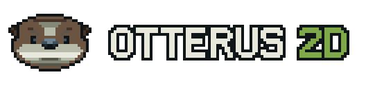

<p align="center">
  
</p>

<p align="center">
  A modular 2D game engine built from scratch in <strong>C++20</strong> and <strong>OpenGL 4.5 Core</strong>, featuring an EnTT-based ECS, Box2D physics, and Lua scripting.
</p>

<p align="center">
  <a href="#quick-start"></a>
  <a href="#tech-stack"></a>
  <a href="#tech-stack"></a>
  <a href="#tech-stack"></a>
  <a href="#tech-stack"></a>
  <a href="LICENSE"></a>
</p>

<p align="center">
  
  <br>
  <em>Showcase scene running on Otterus2D: tilemap, animated sprites, particle weather, and spatial audio driven by Lua scripts.</em>
</p>

---

## Highlights

- **Batched 2D Renderer**: Dynamic sprite batching, layer sorting, shape primitives (rectangles, circles, lines), and font atlases on modern OpenGL 4.5 Core.
- **Data-Oriented ECS**: EnTT registry with decoupled plain data components and linear, cache-friendly system iterations.
- **Lua Scripting**: Lua 5.3 and Sol3 integration exposing entities, cameras, state stacks, input, and physics callbacks.
- **Box2D Physics**: Static, kinematic, and dynamic rigid bodies with contact listener callbacks bridged to ECS entities.
- **Editor Workspace**: Built with Dear ImGui, featuring docking, scene viewport framebuffer (FBO), and filterable log console.

---

## Features

| Area | What's included |
| :--- | :--- |
| **Rendering** | Dynamic batching, layer-sorted sprites, primitives (rect, circle, line), TrueType text, 2D camera, framebuffers |
| **ECS** | EnTT registry with transform, sprite, animation, collider, physics, text, and script components |
| **Scripting** | Lua access to entities, input, assets, timers, random, game state stack, and follow camera |
| **Physics** | Static, kinematic, and dynamic bodies, sensors and triggers, runtime collider debug view |
| **Audio** | Streamed music (MP3) and multi-channel sound effects (WAV) via SDL2_mixer |
| **Assets** | Cached textures, shaders, fonts, and audio managed through a central `AssetManager` |
| **Tooling** | ImGui editor shell, scene viewport, filterable log console, structured logger with source locations |

---

## Documentation

Comprehensive documentation is available in the [Otterus2D Documentation Repository](https://github.com/Umair-Manzoor-47/Otterus2D-docs):

- **[Getting Started Guide](https://github.com/Umair-Manzoor-47/Otterus2D-docs)**: Environment setup, engine concepts, and first project walkthrough.
- **[Architecture & Internals](https://github.com/Umair-Manzoor-47/Otterus2D-docs)**: Subsystem boundaries, static library layering, and frame execution lifecycle.
- **[ECS Components & Lua API Reference](https://github.com/Umair-Manzoor-47/Otterus2D-docs)**: Complete component specifications and Sol3 scripting interface.
- **[How-To Recipes](https://github.com/Umair-Manzoor-47/Otterus2D-docs)**: Practical guides for collision handling, audio playback, and custom cameras.

---

## Quick Start

### Requirements

- Windows 10/11 (64-bit)
- Visual Studio 2022 (MSVC v143+) with C++20 support
- CMake 3.20+
- GPU with OpenGL 4.5 support

> **Dependencies**: Prebuilt third-party libraries are hosted on the releases page. Download [`dependencies-win-x64.zip`](https://github.com/Umair-Manzoor-47/Otterus2D/releases/tag/deps-win-x64-v1) and extract it into the repository root so that `Dependencies/` resides alongside `CMakeLists.txt`. The bundle contains x64 MSVC builds with static runtime linkage (`/MT` Release, `/MTd` Debug).

### Build

```powershell
git clone https://github.com/Umair-Manzoor-47/Otterus2D.git
cd Otterus2D

# Download and extract prebuilt dependencies into ./Dependencies
Invoke-WebRequest -Uri "https://github.com/Umair-Manzoor-47/Otterus2D/releases/download/deps-win-x64-v1/dependencies-win-x64.zip" -OutFile deps.zip
Expand-Archive deps.zip -DestinationPath .
Remove-Item deps.zip

cmake -B build -S . -DCMAKE_BUILD_TYPE=Release
cmake --build build --config Release
```

### Run

A post-build step automatically copies runtime DLLs and `assets/` adjacent to the executable.

```powershell
cd build/bin
.\OTTERUS_EDITOR.exe
```

When using a multi-config Visual Studio generator, the binary is located at `build/bin/Release/OTTERUS_EDITOR.exe`.

---

## Tech Stack

| Library | Version | Used for |
| :--- | :--- | :--- |
| SDL2 / SDL2_mixer | 2.26.5 / 2.6.3 | Window, input, audio |
| EnTT | 3.12.2 | ECS |
| Box2D | 2.4.x | Physics |
| Lua + Sol3 | 5.3.5 / 3.2.3 | Scripting |
| GLM | 1.0.3 | Math |
| Dear ImGui | 1.93 WIP | Editor UI |
| GLAD, SOIL / stb | n/a | OpenGL loading, images, font baking |

---

## Roadmap

**Status:** active development

- [ ] UI system (layout containers, buttons, sliders, input fields)
- [ ] Editor panels: scene hierarchy, component inspector, asset browser
- [ ] Decouple editor from engine
- [ ] Linux build support
- [ ] Automated tests and CI

---

## Links

- **Author:** Umair Manzoor
<!-- ... - **Devlog:** `[TODO: YouTube link]` ...-->
- **LinkedIn:** [Umair Manzoor](https://www.linkedin.com/in/umair-manzoor/)
- **Issues:** [github.com/Umair-Manzoor-47/Otterus2D/issues](https://github.com/Umair-Manzoor-47/Otterus2D/issues)
- **License:** [MIT](LICENSE)