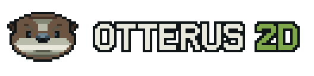
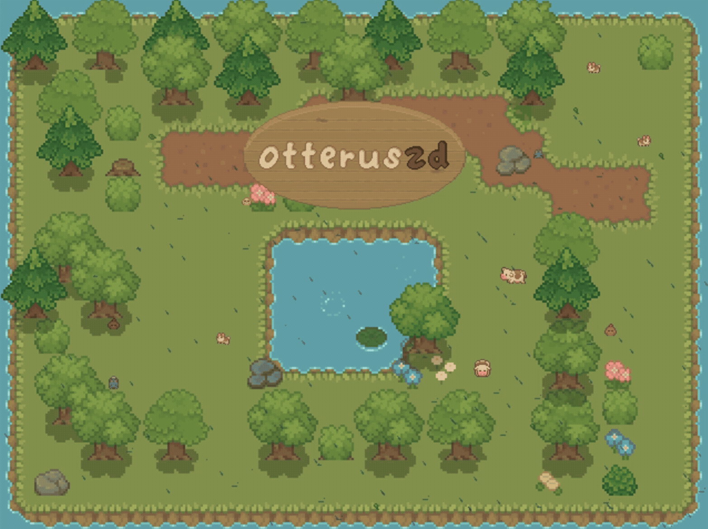

<p align="center">
  
</p>

<p align="center">
  A 2D game engine written from scratch in C++20 and OpenGL 4.5 Core, with an EnTT-based ECS, Box2D physics, and Lua scripting.
</p>

<p align="center">
  <a href="#getting-started"></a>
  <a href="#libraries"></a>
  <a href="#libraries"></a>
  <a href="#libraries"></a>
  <a href="#libraries"></a>
  <a href="#libraries"></a>
</p>

<p align="center">
  
  <br>
  <em>A demo scene running on Otterus2D: tilemap, animated sprites, particle weather, and spatial audio, all driven by Lua scripts.</em>
</p>

---
## Features

| Area | What it does |
| :--- | :--- |
| **Rendering** | Batched, layer-sorted sprites; rect, circle, and line primitives; TrueType text; 2D camera; framebuffers |
| **ECS** | EnTT registry with transform, sprite, animation, collider, physics, text, and script components |
| **Scripting** | Lua bindings for entities, input, assets, timers, random numbers, the game state stack, and a follow camera |
| **Physics** | Static, kinematic, and dynamic bodies; sensors and triggers; a collider debug view at runtime |
| **Audio** | Streamed MP3 music and multi-channel WAV sound effects |
| **Assets** | Textures, shaders, fonts, and audio are loaded once and cached by `AssetManager` |
| **Tooling** | ImGui editor with a scene viewport and a filterable log console; the logger records source locations |

## Documentation

Guides and references are in the [Otterus2D docs repository](https://github.com/Umair-Manzoor-47/Otterus2D-docs): a getting-started walkthrough, architecture notes (subsystem boundaries, library layering, frame lifecycle), the ECS component and Lua API reference, and short how-to recipes for collisions, audio, and custom cameras.

---

## Getting Started

### Requirements

- Windows 10 or 11 (64-bit)
- Visual Studio 2022 or newer with the MSVC v143+ toolset (C++20)
- CMake 3.20+
- A GPU with OpenGL 4.5 support
- [vcpkg](https://github.com/microsoft/vcpkg), if you want to build with CMake directly (`build.bat` installs it for you if it's missing)

All third-party dependencies are listed in `vcpkg.json` and restored automatically, so there is nothing to download by hand. See [Libraries](#libraries) for the full list.

### Build

Clone the repository and run the build script:

```powershell
git clone https://github.com/Umair-Manzoor-47/Otterus2D.git
cd Otterus2D
.\build.bat
```

The script builds a Release configuration by default. Pass `Debug` for a debug build:

```powershell
.\build.bat Debug
```

### Run

A post-build step copies the required runtime DLLs next to the executable, so the editor runs straight from the output folder:

```powershell
.\build\bin\Release\OTTERUS_EDITOR.exe
```

For a Debug build, use `.\build\bin\Debug\OTTERUS_EDITOR.exe`.

---

### Building with CMake directly

If you already have vcpkg set up and `VCPKG_ROOT` defined, you can skip `build.bat`:

```powershell
cmake -B build -S . -DCMAKE_TOOLCHAIN_FILE="$env:VCPKG_ROOT/scripts/buildsystems/vcpkg.cmake" -DVCPKG_TARGET_TRIPLET="x64-windows"
cmake --build build --config Release
```

### Using an IDE

**Visual Studio 2022:** choose *Open a Local Folder* and select the repository. Visual Studio detects `CMakeLists.txt` and `vcpkg.json` and restores dependencies on its own. Set `OTTERUS_EDITOR.exe` as the startup item and press **F5**.

**CLion:** open the repository folder, then go to *Settings → Build, Execution, Deployment → CMake* and add the following to *CMake options* (use your own vcpkg path):

```
-DCMAKE_TOOLCHAIN_FILE=<path-to-vcpkg>/scripts/buildsystems/vcpkg.cmake -DVCPKG_TARGET_TRIPLET=x64-windows
```

Select the `OTTERUS_EDITOR` target and run it with **Shift + F10**.

---

## Libraries

| Library | Version | Source | Used for |
| :--- | :--- | :--- | :--- |
| SDL2 / SDL2_mixer | 2.32+ / 2.8+ | vcpkg | Windowing, input, and audio |
| Box2D | 2.4.1 | vcpkg | Rigid-body physics |
| EnTT | 3.16+ | vcpkg | Entity Component System |
| fmt | 11.0+ | vcpkg | Log message formatting |
| Lua / sol2 (Sol3) | 5.4+ / 3.5+ | vcpkg | Scripting and C++ bindings |
| GLM | 1.0.3+ | vcpkg | Vector and matrix math |
| RapidJSON | Latest | vcpkg | JSON serialization |
| tinyfiledialogs | 3.21+ | vcpkg | Native file dialogs |
| Dear ImGui | Docking branch | In-tree | Editor UI |
| GLAD | OpenGL 4.5 Core | In-tree | OpenGL function loader |
| SOIL / stb | n/a | In-tree | Image decoding and texture loading |

## Roadmap

- [ ] UI system (layout containers, buttons, sliders, input fields)
- [ ] Editor panels: scene hierarchy, component inspector, asset browser
- [ ] Decouple the editor from the engine
- [ ] Linux build support
- [ ] Automated tests and CI

## Links

- **Author:** Umair Manzoor ([LinkedIn](https://www.linkedin.com/in/umair-manzoor/))
<!-- - **Devlog:** `[TODO: YouTube link]` -->
- **Issues:** [github.com/Umair-Manzoor-47/Otterus2D/issues](https://github.com/Umair-Manzoor-47/Otterus2D/issues)
- **License:** [MIT](LICENSE)
