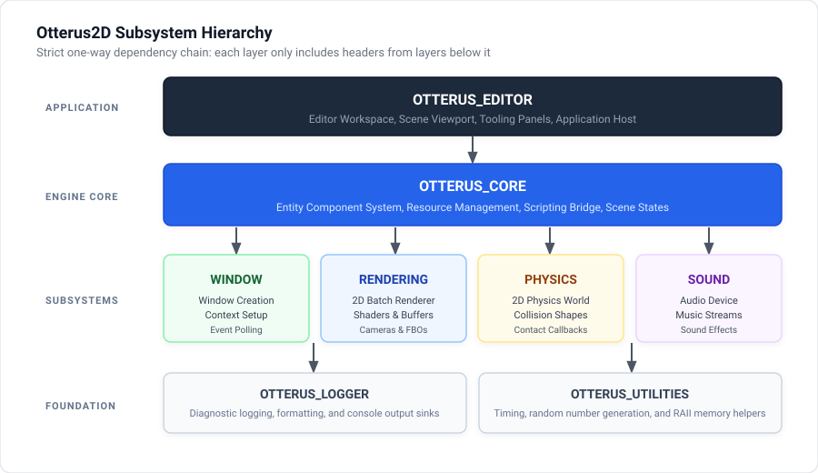
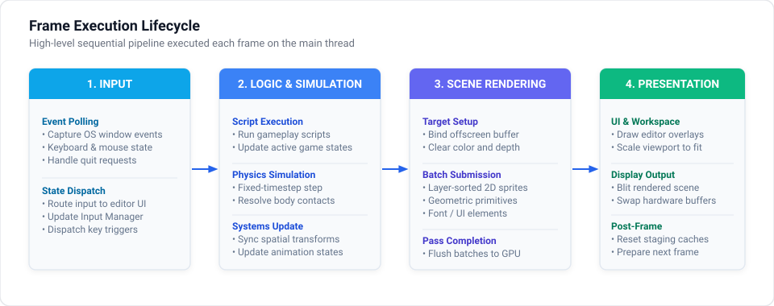

# Engine Architecture and Overview

Otterus2D is a 2D game engine built with C++20 and OpenGL 4.5 Core, utilizing an EnTT-based Entity Component System (ECS), Box2D physics, and Lua scripting via Sol3.

---

## 1. Subsystem Hierarchy and Dependencies

The engine uses a layered static library architecture with a strict one-way dependency chain:

  

### Architectural Rules
- **No Inverted Dependencies**: Specialized subsystems (`Rendering`, `Physics`, `Sound`, `Window`) never include headers from `Core` or `Editor`.
- **Decoupled Communication**: Physics and rendering do not communicate directly; they are coordinated through `OTTERUS_CORE` systems.
- **Resource Encapsulation**: Low-level handles (OpenGL IDs, SDL pointers) must be managed via RAII or centrally through `AssetManager`.

---

## 2. Frame Execution Lifecycle

  

Each frame runs sequentially on the main thread across four distinct stages:

| Stage | Operation | Handled By |
| :--- | :--- | :--- |
| **1. Input** | Polls OS events and updates keyboard and mouse states. | `OTTERUS_WINDOW`, `InputManager` |
| **2. Logic Update** | Executes Lua update hooks, steps Box2D physics at fixed 60 Hz, syncs transforms, and advances animations. | `ScriptingSystem`, `PhysicsSystem`, `AnimationSystem` |
| **3. Render** | Renders layer-sorted sprites, primitive shapes, and text to an offscreen Framebuffer (FBO). | `RenderSystem`, `RenderShapeSystem`, `RenderUISystem` |
| **4. Presentation** | Renders the ImGui editor shell, displays the FBO inside the scene viewport, and swaps buffers. | `OTTERUS_EDITOR`, `SDL_GL_SwapWindow` |

---

## 3. Core Design Decisions

- **Single-Threaded Model**: OpenGL calls, physics simulation, and Lua execution all reside on the main thread.
- **EnTT Context Storage**: Shared services (`AssetManager`, `Renderer`, `b2World`, `Camera2D`, `sol::state`) are stored directly in the central registry context (`registry.ctx()`).
- **Deferred Physics Mutations**: Box2D bodies must not be destroyed inside collision callbacks; state changes must be deferred until the step completes.

---

## 4. Related Reference Documents

For detailed technical specifications, refer to the dedicated documents:

- [ECS Components Reference](../reference/ecs_components.md): Field definitions and Lua usage for all engine components.
- **Lua Scripting API Reference** *(Upcoming)*: Global functions, input queries, audio, and logging interfaces.
- **AssetManager Reference** *(Upcoming)*: Texture, shader, font, and audio caching mechanics.
