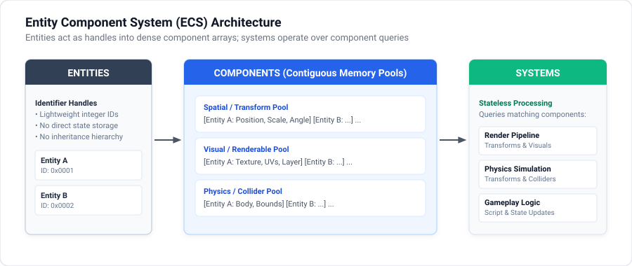

# ECS Components Reference

In Otterus2D, components are plain data structures (PODs) managed by EnTT. They contain no gameplay logic; logic is handled exclusively by systems.

<p align="center">
  
</p>

---

## Component Summary

| Component | Lua Usertype | Purpose | Handled By |
| :--- | :--- | :--- | :--- |
| `TransformComponent` | `Transform` | World position, scale, and rotation. | `RenderSystem`, `PhysicsSystem` |
| `SpriteComponent` | `Sprite` | Texture rendering, dimensions, UV coordinates, layer sorting. | `RenderSystem` |
| `AnimationComponent` | `Animation` | Frame-based sprite sheet animation parameters. | `AnimationSystem` |
| `BoxColliderComponent` | `BoxCollider` | Axis-aligned bounding box for overlap detection. | `PhysicsSystem` |
| `CircleColliderComponent` | `CircleCollider` | Radial bounding area for overlap detection. | `PhysicsSystem` |
| `PhysicsComponent` | `PhysicsComponent` | Box2D rigid body configuration and simulation handle. | `PhysicsSystem` |
| `RigidBodyComponent` | `RigidBody` | Simple non-Box2D kinematic velocity vector. | `PhysicsSystem` |
| `TextComponent` | `TextComponent` | TrueType font rendering, text string, and color. | `RenderUISystem` |
| `ScriptComponent` | *(Internal)* | C++ engine hook running `main.lua`. | `ScriptingSystem` |
| `Identification` | *(Internal)* | Entity name and group metadata; queried via `entity:name()`. | `Registry` |

---

## 1. TransformComponent (`Transform`)

Defines spatial transformation in 2D world space.

### Fields

| Field | Type | Default | Description |
| :--- | :--- | :--- | :--- |
| `position` | `vec2` | `(0.0, 0.0)` | World coordinates (x, y). |
| `scale` | `vec2` | `(1.0, 1.0)` | Scaling factor along x and y axes. |
| `rotation` | `float` | `0.0` | Rotation angle in degrees. |

### Lua Usage

```lua
-- Construct with position, scale, rotation:
local transform = entity:add_component(
    Transform(vec2(100.0, 200.0), vec2(1.0, 1.0), 0.0)
)

-- Or construct with raw coordinates:
-- Transform(x, y, scale_x, scale_y, rotation)

transform.position = vec2(150.0, 250.0)
transform.rotation = 45.0
```

---

## 2. SpriteComponent (`Sprite`)

Defines visual appearance using a cached texture from `AssetManager`.

### Fields

| Field | Type | Default | Description |
| :--- | :--- | :--- | :--- |
| `texture_name` | `string` | `""` | Key of the loaded texture in `AssetManager`. |
| `width` | `float` | `0.0` | Rendered width in world units. |
| `height` | `float` | `0.0` | Rendered height in world units. |
| `start_x` | `int` | `0` | Pixel X offset within sprite sheet. |
| `start_y` | `int` | `0` | Pixel Y offset within sprite sheet. |
| `layer` | `int` | `0` | Render sorting order (lower draws first). |
| `color` | `Color` | `(255, 255, 255, 255)` | RGBA tint multiplier. |

### Lua Usage

```lua
-- Constructor parameters: texture_name, width, height, start_x, start_y, layer
local sprite = entity:add_component(
    Sprite("player_tex", 32.0, 32.0, 0, 0, 1)
)

-- Generates normalized UV coordinates from texture dimensions
sprite:generate_uvs()
```

---

## 3. AnimationComponent (`Animation`)

Cycles UV coordinates of a `Sprite` across frames in a sprite sheet.

### Fields

| Field | Type | Default | Description |
| :--- | :--- | :--- | :--- |
| `num_frames` | `int` | `1` | Total number of animation frames. |
| `frame_rate` | `int` | `1` | Playback speed in frames per second. |
| `frame_Offset` | `int` | `0` | Starting frame index. |
| `current_frame` | `int` | `0` | Currently active frame index. |
| `is_vertical` | `bool` | `false` | True if frames are stacked vertically. |
| `looped` | `bool` | `false` | True to loop playback indefinitely. |

### Lua Usage

```lua
-- Constructor parameters: num_frames, frame_rate, frame_offset, is_vertical, looped
local anim = entity:add_component(
    Animation(6, 12, 0, false, true)
)

-- Reset animation to frame 0
anim:reset()
```

---

## 4. BoxColliderComponent (`BoxCollider`)

Defines an axis-aligned rectangular boundary for simple trigger or distance queries.

### Fields

| Field | Type | Default | Description |
| :--- | :--- | :--- | :--- |
| `width` | `int` | `1` | Box width in pixels/units. |
| `height` | `int` | `1` | Box height in pixels/units. |
| `offset` | `vec2` | `(0.0, 0.0)` | Offset relative to entity transform. |
| `is_colliding` | `bool` | `false` | Flag set when an intersection occurs. |

### Lua Usage

```lua
-- Constructor parameters: width, height, offset
local box = entity:add_component(
    BoxCollider(32, 32, vec2(0.0, 0.0))
)
```

---

## 5. CircleColliderComponent (`CircleCollider`)

Defines a radial boundary for simple distance-based collision queries.

### Fields

| Field | Type | Default | Description |
| :--- | :--- | :--- | :--- |
| `radius` | `float` | `0.0` | Radius of the collision circle. |
| `offset` | `vec2` | `(0.0, 0.0)` | Center offset relative to transform. |
| `is_colliding` | `bool` | `false` | Flag set when an intersection occurs. |

### Lua Usage

```lua
-- Constructor parameter: radius, [offset]
local circle = entity:add_component(CircleCollider(16.0))
```

---

## 6. PhysicsComponent (`PhysicsComponent`)

Wraps a Box2D physical body (`b2Body`) for full rigid-body dynamics, forces, and contacts.

### Attributes (`PhysicsAttributes`)

| Field | Type | Default | Description |
| :--- | :--- | :--- | :--- |
| `type` | `BodyType` | `BodyType.STATIC` | Body mode: `STATIC`, `KINEMATIC`, `DYNAMIC`. |
| `density` | `float` | `1.0` | Material mass density. |
| `friction` | `float` | `0.2` | Surface friction coefficient. |
| `restitution` | `float` | `0.2` | Bounciness (restitution coefficient). |
| `gravityScale` | `float` | `1.0` | Multiplier for global gravity. |
| `isSensor` | `bool` | `false` | If true, detects overlap without physical reaction. |
| `fixedRotation`| `bool` | `true` | Prevents rotational torque from external forces. |
| `boxShape` | `bool` | `true` | True for box fixture; false for circle. |
| `boxSize` | `vec2` | `(0.0, 0.0)` | Width and height if `boxShape` is true. |
| `radius` | `float` | `0.0` | Circle radius if `circle` is true. |
| `objectData` | `ObjectData` | `{}` | Contact metadata passed to `ContactListener`. |

### Runtime Methods

| Method | Parameters | Description |
| :--- | :--- | :--- |
| `physics:linear_impulse(vec2)` | `vec2` | Apply sudden impulse force. |
| `physics:angular_impulse(float)`| `float` | Apply rotational torque impulse. |
| `physics:set_linear_velocity(vec2)` | `vec2` | Directly set linear velocity vector. |
| `physics:get_linear_velocity()` | None | Returns current linear velocity `vec2`. |
| `physics:set_angular_velocity(float)` | `float` | Set rotational speed. |
| `physics:get_angular_velocity()` | None | Returns current rotational speed. |
| `physics:set_gravity_scale(float)` | `float` | Adjust gravity scale at runtime. |
| `physics:set_transform(vec2)` | `vec2` | Teleport body to world position. |

### Lua Usage

```lua
local attr = PhysicsAttributes.new()
attr.type = BodyType.DYNAMIC
attr.density = 1.0
attr.friction = 0.3
attr.boxShape = true
attr.boxSize = vec2(32.0, 32.0)
attr.fixedRotation = true

local physics = entity:add_component(PhysicsComponent.new(attr))
physics:linear_impulse(vec2(0.0, -5.0))
```

---

## 7. RigidBodyComponent (`RigidBody`)

Lightweight, non-Box2D kinematic velocity component for simple programmatic movement.

### Fields

| Field | Type | Default | Description |
| :--- | :--- | :--- | :--- |
| `velocity` | `vec2` | `(0.0, 0.0)` | Linear velocity vector in world units. |

### Lua Usage

```lua
-- Constructor parameter: velocity
local rb = entity:add_component(RigidBody(vec2(150.0, 0.0)))
rb.velocity = vec2(200.0, 0.0)
```

---

## 8. TextComponent (`TextComponent`)

Renders TrueType text using a font loaded in `AssetManager`.

### Fields

| Field | Type | Default | Description |
| :--- | :--- | :--- | :--- |
| `textStr` | `string` | `""` | The string content to render. |
| `fontName` | `string` | `"pixel"` | Font identifier in `AssetManager`. |
| `padding` | `int` | `0` | Pixel spacing between characters. |
| `wrap` | `float` | `-1.0` | Max width before wrapping (`-1.0` disables wrap). |
| `color` | `Color` | `(255, 255, 255, 255)` | Text color tint. |
| `isHidden` | `bool` | `false` | Toggle visibility without removing component. |

### Lua Usage

```lua
-- Constructor parameters: fontName, textStr
local text = entity:add_component(
    TextComponent("pixel", "Score: 100")
)
text.textStr = "Score: 250"
```
